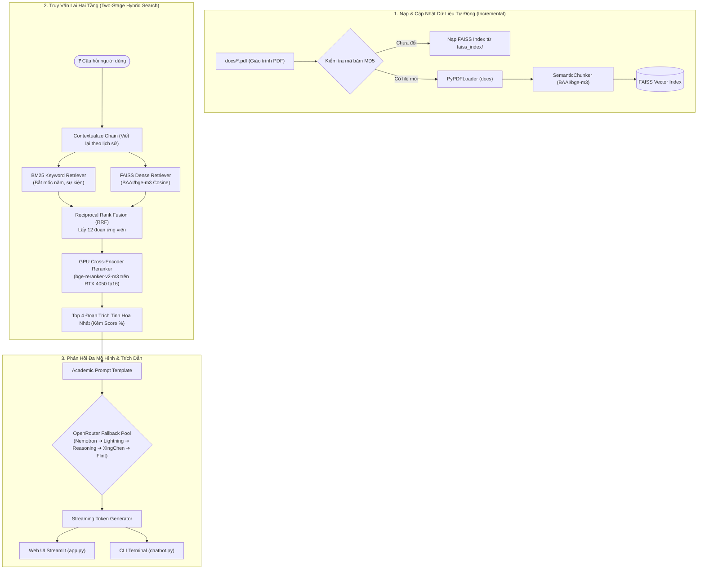

# 📚 RAG Chatbot v2.2 - Trợ Lý Học Thuật Lịch Sử Đảng Cộng Sản Việt Nam

Hệ thống tra cứu học thuật và hỏi đáp thông minh dựa trên kỹ thuật **RAG Hai Tầng (Two-Stage Retrieval-Augmented Generation)** tiên tiến, được thiết kế chuyên sâu nhằm giải đáp các câu hỏi học tập, nghiên cứu và ôn thi từ giáo trình chuẩn *Lịch sử Đảng Cộng sản Việt Nam* (Bộ GD&ĐT).

Dự án sở hữu kiến trúc hiện đại, hỗ trợ song song cả **Giao diện Web Streamlit (Monochrome Minimalist)** và **Giao diện Dòng lệnh (CLI Terminal)**, tích hợp **Streaming Output thời gian thực**, **Truy vấn lai Hybrid Search (BM25 + FAISS Dense Vector)**, **GPU Cross-Encoder Reranker (`BAAI/bge-reranker-v2-m3`)** trên card đồ họa NVIDIA RTX, cùng **Cơ chế tự động dự phòng (Multi-Model Fallback) giữa 5 mô hình LLM miễn phí** trên nền tảng OpenRouter.

---

## ✨ Điểm Nổi Bật & Tính Năng Mới (v2.2)

* **🌐 Giao Diện Web Streamlit Đẳng Cấp (Monochrome Minimalist):**
  * Tông màu trắng thanh lịch kết hợp các điểm nhấn nút bấm màu đen sang trọng.
  * **2 Không Gian Chức Năng (Tabs):**
    1. `💬 Hỏi Đáp & Trích Dẫn`: Khung chat tương tác mượt mà, hỗ trợ Streaming hiển thị từng từ theo thời gian thực, các thẻ câu hỏi gợi ý nhanh theo chủ đề mốc lịch sử (1930, 1945, 1954, 1986).
    2. `🏛️ Mốc Lịch Sử Đảng`: Trục thời gian trực quan tích hợp thẻ tương tác Material-UI (thông qua `streamlit-elements`), tóm tắt các sự kiện bản lề, dẫn chiếu số trang giáo trình và hỗ trợ gửi câu hỏi 1-click.
  * Tùy chọn linh hoạt mô hình phản hồi ngay trên Sidebar.
* **⚡ Phản Hồi Dạng Dòng Chảy (Real-time Streaming):** Cả phiên bản Web lẫn CLI Terminal đều stream câu trả lời liên tục theo từng token, giảm thiểu tối đa độ trễ chờ đợi (Time-to-First-Token cực thấp).
* **🎯 Truy Vấn Lai Kết Hợp (Hybrid Search: BM25 + FAISS Dense):**
  * **BM25 Retriever:** Bắt trúng chính xác các từ khóa đặc thù, tên riêng lãnh tụ, địa danh, tên hội nghị và các mốc năm (1930, 1945, 1954, 1975, 1986...).
  * **FAISS Dense Retriever (BGE-M3):** Bắt trọn ngữ nghĩa đa tầng và câu hỏi diễn đạt tự nhiên của người dùng.
  * **Reciprocal Rank Fusion (RRF):** Kết hợp và trích xuất đồng thời 12 đoạn văn bản ứng viên tiềm năng nhất.
* **🧠 GPU Cross-Encoder Reranker (`BAAI/bge-reranker-v2-m3`):**
  * Tận dụng sức mạnh tính toán song song trên GPU NVIDIA (RTX 4050, `torch.float16`) để thực hiện Cross-Attention giữa câu hỏi và từng đoạn trích.
  * Chuẩn hóa điểm tương đồng theo phân phối Sigmoid ($0.0 \to 1.0$) và chọn lọc ra **Top 4 đoạn trích tinh hoa nhất** chuyển vào ngữ cảnh của LLM.
* **📖 Hộp Trích Dẫn Nguồn Minh Bạch & Chống Ảo Giác:**
  * Mỗi câu trả lời của trợ lý đều đi kèm hộp Accordion chi tiết: **Số trang cụ thể trong giáo trình**, **Tên file nguồn**, **Độ khớp chính xác (%)** và **Đoạn trích dẫn nguyên văn** để đối chiếu học thuật.
* **🔄 Tự Động Cập Nhật Ngữ Liệu Mới (Incremental Indexing):**
  * Hệ thống tự động quét và tính mã băm MD5 các file PDF trong thư mục `docs/`. Khi có file mới hoặc thay đổi, hệ thống tự nạp bổ sung vào FAISS Vectorstore mà không cần xóa cache thủ công.
* **🤖 Multi-Model Fallback 100% Free (OpenRouter API):**
  * Tự động điều phối và chuyển mạch thông minh giữa 5 mô hình mã nguồn mở hàng đầu:
    1. `nvidia/nemotron-3.5-super-vl:free` – (Mặc định) Ngữ cảnh 1.000.000 tokens, đọc hiểu tiếng Việt xuất sắc.
    2. `nvidia/nemotron-3.5-lightning:free` – Tốc độ phản hồi cực nhanh, độ trễ thấp.
    3. `nvidia/nemotron-3-nano-omni-30b-a3b-reasoning:free` – Chuyên sâu suy luận logic phức tạp.
    4. `xingchen-agi/xing4.0-29b-a4b:free` – Năng lực tổng hợp kiến thức đa tầng.
    5. `recursive/flint-v1.0:free` – Lớp dự phòng bền bỉ với ngữ cảnh dài 262k tokens.
* **🧠 Bộ Nhớ Hội Thoại Đa Lượt (Multi-turn Contextual Memory):**
  * Tự động giải quyết các đại từ liên hệ (*"ông ấy", "sự kiện đó", "kết quả ra sao"*) bằng cách viết lại câu hỏi hoàn chỉnh trước khi tìm kiếm.
  * Lưu trữ lịch sử đàm thoại liên tục vào `chat_history.json`.

---

## 🏗️ Kiến Trúc Hệ Thống (Two-Stage RAG Pipeline)



---

## 📁 Cấu Trúc Thư Mục Dự Án

```text
chatbot_rag/
├── docs/                     # Thư mục chứa tài liệu/giáo trình PDF (textbook_LSD.pdf)
├── faiss_index/              # Cache cơ sở dữ liệu vector FAISS (tự động sinh)
├── .streamlit/               # Cấu hình giao diện và theme Streamlit
│   └── config.toml           # Theme Monochrome Minimalist (nền trắng, chữ đen)
├── chat_history.json         # Lịch sử đàm thoại đa lượt (tự động cập nhật)
├── .env                      # File chứa khóa OPENROUTER_API_KEY (không commit)
├── .env.example              # File mẫu cấu hình biến môi trường
├── .gitignore                # Danh sách loại trừ khỏi Git
├── rag_core.py               # LÕI RAG CHUNG: Hybrid Search, Reranker GPU, Streaming
├── app.py                    # GIAO DIỆN WEB STREAMLIT: Monochrome UI, 2 Tabs
├── chatbot.py                # GIAO DIỆN DÒNG LỆNH (CLI): Interactive Terminal
├── requirements.txt          # Danh sách thư viện phụ thuộc (Python 3.10+)
└── README.md                 # Tài liệu hướng dẫn toàn diện dự án
```

---

## ⚙️ Yêu Cầu Kỹ Thuật

* **Hệ điều hành:** Linux (Ubuntu 20.04/22.04/24.04 khuyên dùng), macOS hoặc Windows 10/11.
* **Python:** Phiên bản 3.10 hoặc 3.11.
* **Phần cứng:**
  * **RAM:** Tối thiểu 8GB (khuyên dùng 16GB).
  * **GPU (Khuyên dùng):** Card đồ họa NVIDIA hỗ trợ CUDA (ví dụ: RTX 3050, RTX 4050, RTX 3060...) để tăng tốc Embedding `bge-m3` và Reranker `bge-reranker-v2-m3` ở chuẩn `float16`.
  * **CPU:** Nếu không có GPU rời, hệ thống vẫn tự động fallback chạy trên CPU (chỉ cần đổi sang `faiss-cpu` và chọn `device="cpu"`).

---

## 🚀 Hướng Dẫn Cài Đặt Chi Tiết

### Bước 1: Clone kho lưu trữ
```bash
git clone https://github.com/KhaiPhong25/chatbot_rag.git
cd chatbot_rag
```

### Bước 2: Tạo và kích hoạt môi trường ảo Python
```bash
# Tạo môi trường ảo
python3 -m venv .venv

# Kích hoạt trên Linux/macOS:
source .venv/bin/activate

# Kích hoạt trên Windows:
# .venv\Scripts\activate
```

### Bước 3: Cài đặt thư viện phụ thuộc

Nâng cấp `pip` và cài đặt từ `requirements.txt`:
```bash
pip install --upgrade pip
pip install -r requirements.txt
```

> [!TIP]
> **Dành cho thiết bị KHÔNG có card đồ họa NVIDIA (Chỉ sử dụng CPU):**
> Gỡ gói `faiss-gpu` và cài đặt bản dành cho CPU:
> ```bash
> pip uninstall -y faiss-gpu
> pip install faiss-cpu
> ```

### Bước 4: Thiết lập API Key OpenRouter

1. Đăng ký tài khoản tại [OpenRouter.ai](https://openrouter.ai/).
2. Tạo khóa API hoàn toàn miễn phí tại [OpenRouter API Keys](https://openrouter.ai/keys).
3. Tạo file `.env` từ file mẫu:
   ```bash
   cp .env.example .env
   ```
4. Điền API Key của bạn vào `.env`:
   ```env
   OPENROUTER_API_KEY=sk-or-v1-xxxxxxxxxxxxxxxxxxxxxxxxxxxxxxxx
   ```

---

## 💻 Hướng Dẫn Khởi Chạy

Dự án hỗ trợ 2 phương thức vận hành tùy theo nhu cầu:

### Cách 1: Khởi chạy Giao Diện Web Streamlit (Khuyên dùng)
```bash
streamlit run app.py
```
* Trình duyệt sẽ tự động mở tại địa chỉ: `http://localhost:8501`.
* **Trải nghiệm:**
  * Rê chuột, chọn các thẻ chủ đề gợi ý hoặc nhập câu hỏi vào ô chat phía dưới.
  * Câu trả lời được stream trực tiếp mượt mà.
  * Mở hộp Accordion trích dẫn nguồn để xem số trang và đoạn văn bản gốc trong giáo trình.
  * Chuyển sang Tab `🏛️ Mốc Lịch Sử Đảng` để khám phá trục thời gian các sự kiện bản lề của Đảng Cộng sản Việt Nam.

### Cách 2: Khởi chạy Giao Diện Dòng Lệnh Terminal (CLI)
```bash
python chatbot.py
```
* **Lệnh điều khiển trong Terminal:**
  * Nhập câu hỏi và nhấn `Enter` để xem phản hồi streaming.
  * Gõ `clear`, `cls` hoặc `reset`: Xóa lịch sử trò chuyện trong `chat_history.json`.
  * Gõ `exit`, `quit` hoặc `q`: Thoát khỏi chương trình.

---

## 💬 Kịch Bản Hỏi Đáp Thực Tế

```text
======================================================================
🤖 HỎI ĐÁP LỊCH SỬ ĐẢNG CSVN (HYBRID RETRIEVAL + GPU RERANKER)
======================================================================

👤 Bạn hỏi: Cương lĩnh chính trị đầu tiên của Đảng được thông qua khi nào và gồm những văn kiện nào?
⏳ Đang kích hoạt Hybrid Search (BM25 + FAISS) & GPU Reranker...

⚡ Phản hồi [via nvidia/nemotron-3.5-super-vl:free]:
Cương lĩnh chính trị đầu tiên của Đảng Cộng sản Việt Nam được thông qua tại **Hội nghị thành lập Đảng** diễn ra từ ngày 6/1 đến đầu tháng 2 năm 1930 tại Cửu Long (Hương Cảng, Trung Quốc) dưới sự chủ trì của lãnh tụ Nguyễn Ái Quốc.

Cương lĩnh bao gồm các văn kiện cốt lõi:
1. **Chính cương vắn tắt của Đảng**
2. **Sách lược vắn tắt của Đảng**
3. **Chương trình tóm tắt của Đảng**
4. **Điều lệ vắn tắt của Đảng**

Văn kiện xác định đường lối chiến lược cách mạng Việt Nam: tiến hành "tư sản dân quyền cách mạng và thổ địa cách mạng để đi tới xã hội cộng sản", đánh đổ đế quốc Pháp và phong kiến tay sai, giành độc lập hoàn toàn cho dân tộc.

📚 [Nguồn trích dẫn: Trang 28 - 32, textbook_LSD.pdf | Độ khớp: 94%]
----------------------------------------------------------------------

👤 Bạn hỏi: Ý nghĩa lịch sử của bản cương lĩnh đó là gì?
⏳ Đang kích hoạt Hybrid Search (BM25 + FAISS) & GPU Reranker...

⚡ Phản hồi [via nvidia/nemotron-3.5-super-vl:free]:
Ý nghĩa lịch sử to lớn của Cương lĩnh chính trị đầu tiên (1930):
- **Chấm dứt khủng hoảng về đường lối cứu nước:** Đưa cách mạng Việt Nam bước vào con đường giải phóng đúng đắn, gắn độc lập dân tộc với chủ nghĩa xã hội.
- **Xác định đúng đắn động lực cách mạng:** Khẳng định giai cấp công nhân lãnh đạo thông qua đội tiên phong là Đảng, khối liên minh công nông là lực lượng nòng cốt.
- **Kim chỉ nam hành động:** Đặt nền tảng tư tưởng và tổ chức vững chắc cho mọi thắng lợi vẻ vang của cách mạng Việt Nam sau này.

📚 [Nguồn trích dẫn: Trang 33 - 35, textbook_LSD.pdf | Độ khớp: 91%]
----------------------------------------------------------------------
```

---

## 🛠️ Tùy Chỉnh Nâng Cao

Bạn có thể dễ dàng điều chỉnh cấu hình sâu trong file [rag_core.py](file:///home/wqfeng/Projects/chatbot_rag/rag_core.py):

* **Tùy chỉnh số lượng đoạn trích sau Rerank:** Thay đổi tham số `top_k_rerank` (mặc định là `4`) trong hàm `stream_with_fallback(...)`.
* **Tùy chỉnh số ứng viên Candidate Retrieval:** Thay đổi tham số `k` (mặc định là `12`) trong hàm `build_hybrid_retriever(vectorstore, k=12)`.
* **Tùy chỉnh mô hình LLM:** Cập nhật hoặc bổ sung các model miễn phí khác vào danh sách `FREE_MODELS`.
* **Tùy chỉnh phân đoạn ngữ nghĩa:** Điều chỉnh `breakpoint_threshold_amount` trong `SemanticChunker` (mặc định ngưỡng phân đoạn là `85%`).

---

## 📄 Bản Quyền & Miễn Trừ Trách Nhiệm

* Dự án phục vụ mục đích học tập, nghiên cứu phi lợi nhuận và hỗ trợ học viên ôn luyện học phần Lịch sử Đảng Cộng sản Việt Nam.
* Toàn bộ phản hồi được tổng hợp tự động từ giáo trình thông qua hệ thống RAG và mô hình ngôn ngữ lớn. Người học vui lòng đối chiếu số trang tham khảo đính kèm trong các bài viết học thuật hoặc kỳ thi chính thức.
