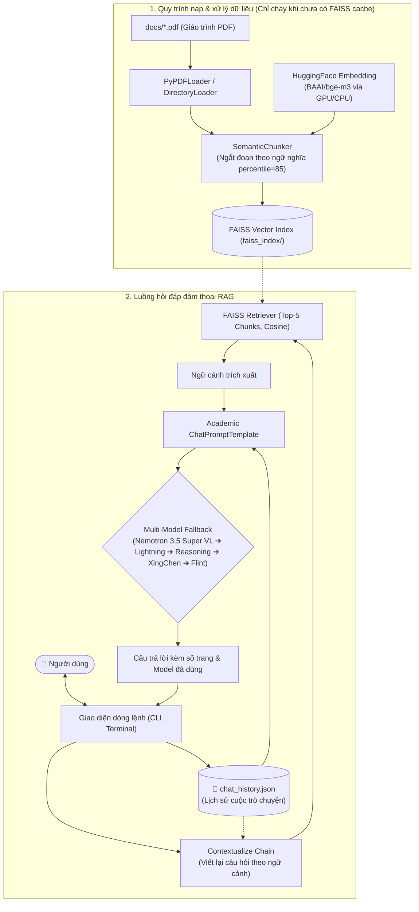

# 📚 RAG Chatbot - Hỏi Đáp Lịch Sử Đảng Cộng Sản Việt Nam

Ứng dụng Chatbot hỏi đáp thông minh dựa trên kỹ thuật **RAG (Retrieval-Augmented Generation)**, cho phép tra cứu, trích xuất thông tin chuẩn xác và giải đáp các câu hỏi học tập từ giáo trình *Lịch sử Đảng Cộng sản Việt Nam*.

Dự án được tối ưu hóa toàn diện bằng việc kết hợp **Embedding cục bộ qua GPU (bge-m3)**, **cơ sở dữ liệu vector FAISS (có cơ chế cache)**, **bộ nhớ hội thoại đa lượt lưu trữ vĩnh viễn (FileChatMessageHistory)**, và **cơ chế tự động dự phòng (Multi-Model Fallback) giữa 5 mô hình LLM miễn phí** trên nền tảng OpenRouter.

---

## ✨ Tính Năng Nổi Bật

* **🚀 100% Free Tier:** Vận hành hoàn toàn bằng các mô hình LLM mã nguồn mở chất lượng cao thông qua OpenRouter API không tốn phí.
* **🔄 Tự Động Fallback Giữa Các Mô Hình Miễn Phí (Multi-Model Fallback):** Hệ thống ưu tiên cao nhất mô hình xuất sắc của NVIDIA và tự động chuyển đổi thông minh giữa các mô hình miễn phí đang hoạt động ổn định trên OpenRouter:
  1. `nvidia/nemotron-3.5-super-vl:free` – **(Ưu tiên số 1)** Siêu mô hình từ NVIDIA, cửa sổ ngữ cảnh cực lớn 1.000.000 tokens, khả năng đọc hiểu ngữ cảnh học thuật và trả lời tiếng Việt xuất sắc.
  2. `nvidia/nemotron-3.5-lightning:free` – **(Fallback 1)** Tốc độ xử lý siêu tốc, độ trễ cực thấp.
  3. `nvidia/nemotron-3-nano-omni-30b-a3b-reasoning:free` – **(Fallback 2)** Mô hình 30B chuyên sâu về suy luận logic (Reasoning).
  4. `xingchen-agi/xing4.0-29b-a4b:free` – **(Fallback 3)** Mô hình 29B tối ưu năng lực đa ngôn ngữ.
  5. `recursive/flint-v1.0:free` – **(Fallback 4)** Lớp dự phòng ổn định với context dài 262k tokens.
* **🧠 Trí Nhớ Ngữ Cảnh Đa Lượt (Multi-turn Memory):**
  * Tự động nhận diện đại từ thay thế (*"ông ấy", "sự kiện đó", "khi nào"*) và viết lại câu hỏi thành truy vấn độc lập trước khi tìm kiếm vector.
  * Tích hợp `FileChatMessageHistory` lưu lịch sử trò chuyện bền vững vào file `chat_history.json`.
  * Hỗ trợ lệnh `clear` để làm mới ngữ cảnh trò chuyện bất cứ lúc nào.
* **✂️ Phân Đoạn Theo Ngữ Nghĩa (Semantic Chunking):** Ứng dụng `SemanticChunker` thay thế cho việc cắt cứng theo số ký tự. Hệ thống tự động đo lường khoảng cách vector giữa các câu kế tiếp và tách đoạn khi có sự biến chuyển chủ đề (ngưỡng percentile 85%), giúp bảo toàn trọn vẹn ngữ cảnh của từng sự kiện lịch sử.
* **⚡ Tối Ưu Tốc Độ Với FAISS Cache:** Chỉ đọc tài liệu PDF và tính toán Semantic Embedding một lần duy nhất lúc khởi tạo. Các lần chạy tiếp theo nạp trực tiếp chỉ mục từ thư mục `faiss_index/` trong chưa đầy 2 giây mà không cần xử lý lại văn bản.
* **🎯 Embedding Tiếng Việt Đỉnh Cao:** Sử dụng mô hình `BAAI/bge-m3` tối ưu đa ngôn ngữ, tăng tốc phần cứng bằng GPU NVIDIA (CUDA) với khoảng cách Cosine Similarity.
* **📖 Trích Dẫn Nguồn Minh Bạch & Chống Ảo Giác:**
  * Prompt thiết kế theo chuẩn học thuật sư phạm, chỉ trả lời dựa trên ngữ cảnh giáo trình được cung cấp.
  * Mỗi phản hồi đều trích dẫn rõ số trang trong giáo trình để người học dễ dàng đối soát.

---

## 🏗️ Kiến Trúc Hệ Thống



---

## 📁 Cấu Trúc Thư Mục

```text
chatbot_rag/
├── docs/                     # Thư mục chứa giáo trình PDF (textbook_LSD.pdf)
├── faiss_index/              # Thư mục cache vector database FAISS (tự sinh)
├── chat_history.json         # Lịch sử đàm thoại đa lượt (tự sinh)
├── .env                      # File cấu hình khóa API (được bảo mật, không commit)
├── .env.example              # File mẫu cấu hình biến môi trường
├── .gitignore                # Danh sách file/thư mục loại trừ khỏi Git
├── chatbot.py                # Mã nguồn chính điều phối luồng RAG
├── requirements.txt          # Danh sách thư viện phụ thuộc
└── README.md                 # Hướng dẫn chi tiết dự án
```

---

## ⚙️ Yêu Cầu Hệ Thống

* **Hệ điều hành:** Linux (Ubuntu 20.04+ khuyên dùng), macOS hoặc Windows 10/11.
* **Python:** Phiên bản 3.10 trở lên.
* **Phần cứng:**
  * RAM: Tối thiểu 8GB (khuyên dùng 16GB).
  * GPU: Khuyên dùng GPU NVIDIA (có hỗ trợ CUDA, ví dụ RTX 3050, 4050...) để nạp mô hình `BAAI/bge-m3` nhanh chóng.
  * *Lưu ý:* Nếu sử dụng CPU, hệ thống vẫn hoạt động bình thường (chỉ cần điều chỉnh cấu hình cài đặt FAISS CPU).

---

## 🚀 Hướng Dẫn Cài Đặt

### Bước 1: Clone kho lưu trữ
```bash
git clone https://github.com/KhaiPhong25/chatbot_rag.git
cd chatbot_rag
```

### Bước 2: Tạo và kích hoạt môi trường ảo
```bash
# Tạo môi trường ảo Python
python3 -m venv .venv

# Kích hoạt trên Linux/macOS:
source .venv/bin/activate

# Kích hoạt trên Windows:
# .venv\Scripts\activate
```

### Bước 3: Cài đặt các thư viện phụ thuộc

Cài đặt các gói cơ bản từ [requirements.txt](file:///home/wqfeng/Projects/chatbot_rag/requirements.txt):
```bash
pip install --upgrade pip
pip install -r requirements.txt
```

> [!TIP]
> **Dành cho máy tính KHÔNG có card đồ họa NVIDIA (Chỉ chạy CPU):**
> Gỡ gói `faiss-gpu` và cài đặt bản cho CPU:
> ```bash
> pip uninstall -y faiss-gpu
> pip install faiss-cpu
> ```
> *(Trong file `chatbot.py`, đổi `model_kwargs={"device": "cuda"}` thành `model_kwargs={"device": "cpu"}` nếu không có GPU)*.

### Bước 4: Thiết lập biến môi trường (API Key)

1. Đăng ký tài khoản tại [OpenRouter.ai](https://openrouter.ai/).
2. Nhận API Key tại mục [OpenRouter API Keys](https://openrouter.ai/keys) (hoàn toàn miễn phí).
3. Tạo file `.env` từ file mẫu:
   ```bash
   cp .env.example .env
   ```
4. Mở file `.env` và cập nhật khóa:
   ```env
   OPENROUTER_API_KEY=sk-or-v1-xxxxxxxxxxxxxxxxxxxxxxxxxxxxxxxx
   ```

---

## 💻 Hướng Dẫn Sử Dụng

### 1. Chuẩn bị tài liệu
Đặt file giáo trình hoặc tài liệu tham khảo định dạng `.pdf` vào thư mục `docs/` (mặc định đã có sẵn file `docs/textbook_LSD.pdf`).

### 2. Khởi chạy Chatbot
```bash
python chatbot.py
```

* **Lần đầu tiên chạy:** Chương trình tải tài liệu, chia đoạn, nhúng embedding và lưu index vào `faiss_index/` (mất khoảng 10-30 giây tùy cấu hình phần cứng).
* **Từ lần thứ hai trở đi:** Chương trình tự phát hiện cache và nạp index trực tiếp, sẵn sàng nhận câu hỏi ngay lập tức.

### 3. Các lệnh điều khiển trong phiên làm việc
* Gõ câu hỏi trực tiếp và nhấn `Enter`.
* Gõ `clear`, `cls` hoặc `reset`: Xóa toàn bộ lịch sử trong [chat_history.json](file:///home/wqfeng/Projects/chatbot_rag/chat_history.json) và bắt đầu phiên hỏi đáp hoàn toàn mới.
* Gõ `exit`, `quit` hoặc `q`: Thoát khỏi chương trình một cách an toàn.

---

## 💬 Kịch Bản Mẫu & Trí Nhớ Ngữ Cảnh

```text
============================================================
🤖 CHATBOT LỊCH SỬ ĐẢNG CỘNG SẢN VIỆT NAM - ĐÃ SẴN SÀNG!
📁 Lịch sử trò chuyện lưu tại: 'chat_history.json'
💡 Lệnh: 'exit'/'q' để thoát | 'clear' để xóa lịch sử hội thoại
============================================================

👤 Bạn hỏi: Tổng Bí thư đầu tiên của Đảng Cộng sản Việt Nam là ai?
⏳ Đang tìm kiếm tài liệu và suy luận câu trả lời...

🤖 Trợ lý [via nvidia/nemotron-3.5-super-vl:free]:
Tổng Bí thư đầu tiên của Đảng ta là đồng chí **Trần Phú**. Đồng chí được bầu giữ cương vị Tổng Bí thư tại Hội nghị Ban Chấp hành Trung ương họp vào tháng 10 năm 1930 tại Hương Cảng (Trung Quốc).

(Nguồn: Giáo trình Lịch sử Đảng Cộng sản Việt Nam, Trang 35)
------------------------------------------------------------

👤 Bạn hỏi: Đồng chí ấy quê ở đâu và hy sinh năm nào?
⏳ Đang tìm kiếm tài liệu và suy luận câu trả lời...

🤖 Trợ lý [via nvidia/nemotron-3.5-super-vl:free]:
- **Quê quán:** Đồng chí Trần Phú sinh ra tại xã An Lộc, huyện Tuy An, tỉnh Phú Yên; quê gốc tại xã Tùng Ảnh, huyện Đức Thọ, tỉnh Hà Tĩnh.
- **Thời gian hy sinh:** Đồng chí hy sinh ngày 6 tháng 9 năm 1931 tại Nhà thương Chợ Quán (Sài Gòn) ở tuổi 27 với lời nhắn nhủ bất hủ: *"Hãy giữ vững chí khí chiến đấu"*.

(Nguồn: Giáo trình Lịch sử Đảng Cộng sản Việt Nam, Trang 36)
------------------------------------------------------------

👤 Bạn hỏi: exit
👋 Tạm biệt bạn! Chúc bạn học tốt.
```

---

## 🛠️ Tùy Chỉnh & Mở Rộng

* **Thay đổi kích thước phân đoạn:** Điều chỉnh tham số `breakpoint_threshold_type` và `breakpoint_threshold_amount` tại hàm `SemanticChunker` trong [chatbot.py](file:///home/wqfeng/Projects/chatbot_rag/chatbot.py#L94-L100).
* **Số lượng đoạn văn bản lấy lại (Top-K):** Điều chỉnh tham số `k` tại `retriever = vectorstore.as_retriever(search_kwargs={"k": 5})` trong [chatbot.py](file:///home/wqfeng/Projects/chatbot_rag/chatbot.py#L138-L141).
* **Thêm mô hình LLM:** Cập nhật danh sách `FREE_MODELS` trong [chatbot.py](file:///home/wqfeng/Projects/chatbot_rag/chatbot.py#L41-L47) với các model có sẵn trên OpenRouter.

---

## 📄 Bản Quyền & Miễn Trừ Trách Nhiệm

* Dự án phục vụ mục đích học tập, nghiên cứu và hỗ trợ sinh viên ôn tập môn học Lịch sử Đảng Cộng sản Việt Nam.
* Toàn bộ nội dung trả lời được tổng hợp tự động từ giáo trình thông qua hệ thống RAG. Vui lòng đối soát lại số trang trích dẫn khi sử dụng cho các bài nghiên cứu hoặc thi cử chính thức.
